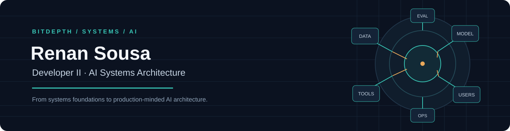
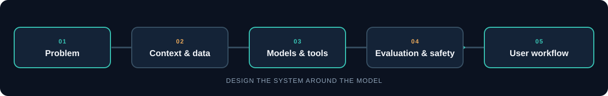

  

### Developer II · AI Systems Architecture

I design software architectures for AI systems, connecting models, data, tools, and real-world workflows.

---

## About

I work as a **Developer II**, contributing to software architecture for AI systems. My current focus is designing how AI components fit into reliable, secure software.

Before moving into software architecture, I worked as a Cisco Solutions Engineer focused on cybersecurity, data centers, and networking. That experience still shapes how I approach AI systems: security, integration, reliability, and operations belong in the design from the start.

I am also studying Software Engineering at **42 São Paulo**, strengthening my foundations in computer science, C, and systems programming.

## What I focus on

<table>
  <tr>
    <td width="50%" valign="top">
      <strong>AI system architecture</strong> 
      Designing how models, data, tools, and applications work together.
    </td>
    <td width="50%" valign="top">
      <strong>LLM applications</strong> 
      Exploring RAG, retrieval, context engineering, and agentic workflows.
    </td>
  </tr>
  <tr>
    <td width="50%" valign="top">
      <strong>Integration and security</strong> 
      Connecting AI capabilities to existing systems with clear trust boundaries.
    </td>
    <td width="50%" valign="top">
      <strong>Reliable operations</strong> 
      Thinking about evaluation, observability, cost, and maintainability.
    </td>
  </tr>
</table>

## How I think about AI systems

  

I care about the complete system around a model: the problem it solves, the information it can use, the tools it can call, and the way its behavior is evaluated and operated.

## BitDepth

**[BitDepth](https://bitdepth.com.br/)** is where I explore software and AI systems through technical articles and practical ideas. The goal is to connect foundations—from low-level computing to modern AI—with the architectural choices behind useful systems.

## Selected work

- **[BitDepth](https://bitdepth.com.br/)** — writing and explorations on software, systems, and AI.
- **[A-Maze-ing](https://github.com/refernandes/a-maze-ing)** — a Python maze generator and reusable package developed at 42 São Paulo.
- **[Sorting Visualizer](https://github.com/refernandes/sorting_visualizer)** — a C and Raylib application for exploring sorting algorithms.

The last two projects show some of the systems and programming foundations behind my current work. I will add AI architecture projects here as they are ready to share publicly.

---

  Systems thinking, applied to AI.

